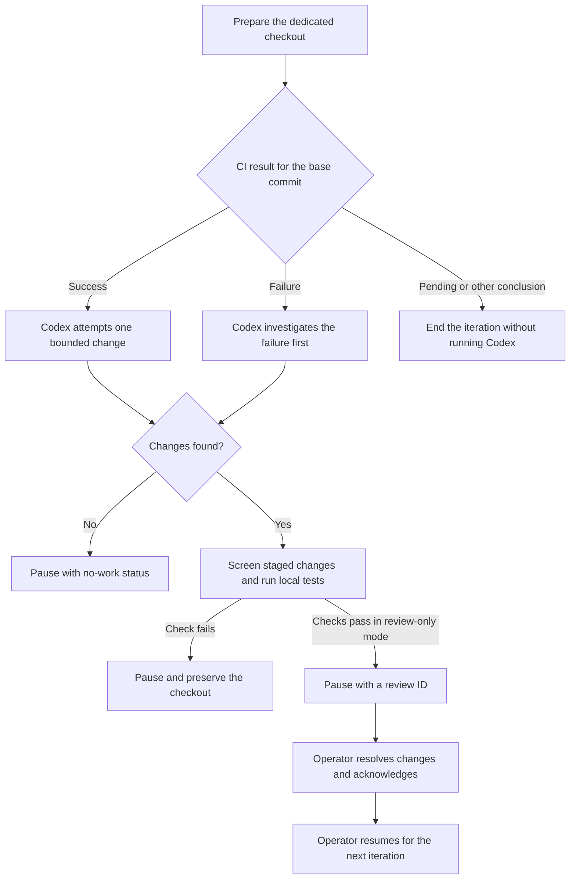

# How DevLoop works

DevLoop coordinates Codex, Git, GitHub Actions, and your test command. Each registered project has its own configuration, checkout, and review state. Your usual working copy is separate. GitHub Actions supplies the CI result for the base commit. Your local tests check the proposed edits before you review them.

The diagram follows the review-only path. DevLoop also stops early if preflight checks fail, the checkout is dirty or divergent, or a pending review needs attention.

## What each check means

1. **Base CI.** DevLoop matches a push run of the configured workflow to the exact starting commit. A confirmed failure directs Codex to investigate first. DevLoop reads up to 512 KiB of failed-step output and passes only fixed diagnostic categories to Codex. These categories are clues for local diagnosis.
2. **Staged changes.** DevLoop checks project path rules and rejects forbidden paths, symlinks, submodules, binary or invalid text, and some common credential formats. The scan limits are 1 MiB per changed file and 16 MiB total. Credential detection is heuristic, and staging already writes blobs into the local Git object store.
3. **Local tests.** DevLoop runs the configured command and checks that the staged tree still matches the screened tree. It also checks checkout identity and selected Git metadata, including config and hooks, after Codex and after tests. Unexpected Git metadata changes block further progress across restarts until resolved.
4. **Review.** The review ID identifies the base commit and tested Git tree. Acknowledgement records that the operator resolved the pending review. It requires a clean checkout on the configured branch with the expected origin and leaves the runner paused until resumed. Older review records can show the base commit as the ID with no tested tree.

See the [quick start](../README.md) for the first run and the [operations guide](operations.md) for commands and isolation.
